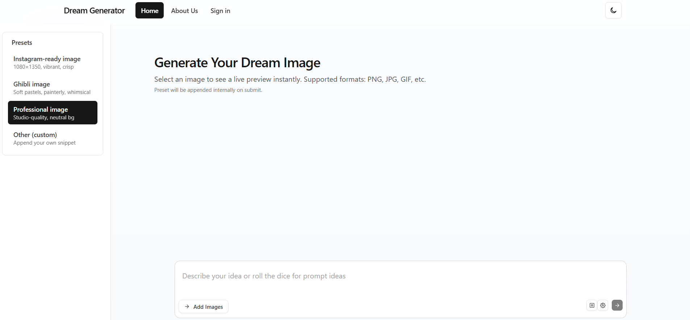

<div align="center">

# 🎨 Dream Image Generator

[](https://nextjs.org/)
[](https://reactjs.org/)
[](https://www.typescriptlang.org/)
[](https://tailwindcss.com/)
[](https://supabase.com/)

**Transform your ideas into stunning visuals with AI-powered image generation**

[Features](#-features) • [Demo](#-demo) • [Installation](#-installation) • [Usage](#-usage) • [Documentation](#-documentation)

</div>

---

## 📖 Overview

Dream Image Generator is a full-featured web application that leverages Google's Gemini AI to transform text prompts and reference images into stunning AI-generated visuals. Built with modern web technologies, it offers an intuitive interface for creators, designers, and developers to rapidly visualize concepts without managing complex ML infrastructure.



## ✨ Features

### Core Capabilities
- 🎯 **Text-to-Image Generation**: Create stunning images from descriptive text prompts
- 🖼️ **Image-to-Image Transformation**: Upload reference images to guide AI generation
- 🎨 **Style Presets**: Quick-apply styles (Instagram-ready, Studio Ghibli-inspired, Professional, and more)
- ⚡ **Real-Time Preview**: Instant image uploads with validation (size, type, count)
- 💾 **Generation History**: Track and revisit your previous creations
- 📚 **Prompt Library**: Browse and use community-curated prompts

### User Experience
- 🌓 **Dark Mode Support**: Seamless theme switching for comfortable viewing
- 📱 **Responsive Design**: Optimized for mobile, tablet, and desktop
- 🔐 **Authentication**: Secure user accounts with Supabase Auth
- 💬 **AI Chat Assistant**: Interactive chat interface for prompt refinement
- ❤️ **Likes System**: Save and organize your favorite generations
- 🔄 **Session Management**: Maintain chat history across sessions

### Technical Features
- 🚀 **Server-Side API**: Secure handling of Gemini API calls
- 🗄️ **Database Integration**: Persistent storage with Supabase
- 📦 **Image Storage**: Cloud storage for generated images
- 🔒 **Protected Routes**: Middleware-based authentication
- 🎭 **Markdown Support**: Rich text rendering in chat

## 🛠️ Tech Stack

| Category | Technologies |
|----------|-------------|
| **Framework** | Next.js 14.2.33 (App Router) |
| **Frontend** | React 18.3.1, TypeScript 5.5.4 |
| **Styling** | Tailwind CSS 3.4.10 |
| **AI/ML** | Google Gemini API (@google/generative-ai) |
| **Backend** | Supabase (Auth, Database, Storage) |
| **Build Tools** | PostCSS, ESLint, TypeScript Compiler |
| **Utilities** | UUID, Base64-ArrayBuffer |

## 📋 Prerequisites

Before you begin, ensure you have the following installed:

- **Node.js** 18.x or higher ([Download](https://nodejs.org/))
- **npm** or **yarn** package manager
- **Git** for version control

You'll also need:
- **Google Gemini API Key** - Obtain from [Google AI Studio](https://aistudio.google.com/app/apikey)
- **Supabase Account** - Sign up at [Supabase](https://supabase.com/) for database and auth services

## 🚀 Installation

### 1. Clone the Repository

```bash
git clone https://github.com/nitishkumarsonkar/dream-image-generator.git
cd dream-image-generator
```

### 2. Install Dependencies

```bash
npm install
# or
yarn install
```

### 3. Environment Configuration

Create a `.env.local` file in the root directory:

```env
# Google Gemini API
NEXT_PUBLIC_GEMINI_API_KEY=your_gemini_api_key_here

# Supabase Configuration
NEXT_PUBLIC_SUPABASE_URL=your_supabase_project_url
NEXT_PUBLIC_SUPABASE_ANON_KEY=your_supabase_anon_key
```

> 💡 **Tip**: Check `SUPABASE_SETUP.md` for detailed Supabase configuration instructions.

### 4. Database Setup

Run the migrations to set up your Supabase database:

```bash
# Apply migrations in order from the migrations/ folder
# See migrations/supabase-migrations.sql for the complete setup
```

### 5. Start Development Server

```bash
npm run dev
```

Open [http://localhost:3000](http://localhost:3000) in your browser to see the application.

## 📱 Usage

### Image Generation

1. **Navigate to Home Page** - The main generation interface
2. **Enter Your Prompt** - Describe the image you want to create
3. **Upload Reference Images** (Optional)
   - Up to 5 images per generation
   - Maximum 5MB per image
   - Supported formats: JPG, PNG, WebP
4. **Select a Preset** - Choose from the sidebar or use custom prompts
5. **Generate** - Click submit and watch your idea come to life
6. **Download or Share** - Save your creation or share it with others

### Chat Assistant

Navigate to `/chat` to interact with the AI assistant:
- Get help refining your prompts
- Ask questions about image generation techniques
- Explore creative ideas with conversational AI
- Sessions are automatically saved for future reference

### Generation History

Access `/history` to:
- View all your previous generations
- Filter and search through your creations
- Re-use successful prompts
- Like and favorite images

### Prompt Library

Explore `/prompt-library` for:
- Curated collection of effective prompts
- Community-shared prompt templates
- Category-based browsing
- Quick-copy functionality

## 📁 Project Structure

```
dream-image-generator/
├── src/
│   ├── app/                      # Next.js App Router
│   │   ├── (home)/              # Home page group
│   │   │   ├── page.tsx         # Main generation interface
│   │   │   └── components/      # Home-specific components
│   │   │       ├── FixedTextarea.tsx
│   │   │       ├── ImageGenerationHistory.tsx
│   │   │       ├── ImageUploader.tsx
│   │   │       ├── PresetsButton.tsx
│   │   │       ├── PresetsModal.tsx
│   │   │       └── Scrollable.tsx
│   │   ├── api/                 # API routes
│   │   │   ├── generate/        # Image generation endpoint
│   │   │   └── chat/            # Chat API endpoints
│   │   ├── auth/                # Authentication flows
│   │   ├── chat/                # Chat interface
│   │   ├── history/             # Generation history
│   │   ├── prompt-library/      # Prompt library page
│   │   ├── about/               # About page
│   │   ├── sign-in/             # Sign-in page
│   │   ├── layout.tsx           # Root layout
│   │   ├── globals.css          # Global styles
│   │   └── middleware.ts        # Route protection
│   ├── components/              # Shared React components
│   │   ├── AuthGuard.tsx        # Authentication wrapper
│   │   ├── ChatHistory.tsx      # Chat history sidebar
│   │   ├── Header.tsx           # Navigation header
│   │   ├── MarkdownText.tsx     # Markdown renderer
│   │   ├── SidebarPresets.tsx   # Preset selection
│   │   └── ThemeToggle.tsx      # Dark mode toggle
│   ├── lib/                     # Utility libraries
│   │   ├── gemini-config.ts     # Gemini API configuration
│   │   ├── presets.ts           # Style presets
│   │   ├── promptHistory.ts     # History management
│   │   ├── promptLibrary.ts     # Prompt library data
│   │   └── share.ts             # Sharing utilities
│   ├── types/                   # TypeScript type definitions
│   │   ├── chat.ts              # Chat types
│   │   └── index.ts             # Global types
│   └── utils/                   # Utility functions
│       └── supabase/            # Supabase client utilities
├── migrations/                  # Database migrations
│   ├── 0001_add_image_generation_tables.sql
│   ├── 0002_storage_policies_prompts_pic.sql
│   ├── 0003_add_source_prompt_id.sql
│   ├── 0004_add_likes_system.sql
│   ├── 0005_add_chat_messages_table.sql
│   └── 0006_add_chat_sessions_table.sql
├── memory-bank/                 # Project documentation
│   ├── productContext.md
│   ├── techContext.md
│   ├── systemPatterns.md
│   └── progress.md
├── public/                      # Static assets
├── package.json                 # Dependencies
├── tsconfig.json               # TypeScript config
├── tailwind.config.js          # Tailwind config
└── next.config.js              # Next.js config
```

## 🔧 Available Scripts

| Command | Description |
|---------|-------------|
| `npm run dev` | Start development server at `http://localhost:3000` |
| `npm run build` | Build optimized production bundle |
| `npm start` | Start production server (requires build first) |
| `npm run lint` | Run ESLint to check code quality |

## 📚 Documentation

Comprehensive documentation is available in the `memory-bank/` directory:

- **[Product Context](memory-bank/productContext.md)** - Product vision, user goals, and success metrics
- **[Technical Context](memory-bank/techContext.md)** - Architecture decisions and technical details
- **[System Patterns](memory-bank/systemPatterns.md)** - Design patterns and coding conventions
- **[Supabase Setup](SUPABASE_SETUP.md)** - Database and authentication configuration
- **[Chat Setup](CHAT_SETUP.md)** - Chat feature implementation guide
- **[Developer Guide](DEVELOPER_GUIDE.md)** - Development best practices

## 🚦 Demo

Try it live: [Add your deployment URL here]

## 🤝 Contributing

Contributions are welcome! Please follow these steps:

1. **Fork the repository**
2. **Create a feature branch**
   ```bash
   git checkout -b feature/amazing-feature
   ```
3. **Commit your changes**
   ```bash
   git commit -m 'Add amazing feature'
   ```
4. **Push to your branch**
   ```bash
   git push origin feature/amazing-feature
   ```
5. **Open a Pull Request**

### Contribution Guidelines

- Follow the existing code style and conventions
- Write clear commit messages
- Add tests for new features
- Update documentation as needed
- Ensure all tests pass before submitting

## 🐛 Known Issues & Limitations

- Maximum file size: 5MB per image
- Maximum images per generation: 5
- API rate limits apply based on Gemini API tier
- Large images may take longer to process

## 🗺️ Roadmap

- [ ] Advanced editing capabilities
- [ ] Batch generation support
- [ ] Custom model fine-tuning
- [ ] Social sharing features
- [ ] Community gallery
- [ ] Mobile app (iOS/Android)

## 📄 License

This project is licensed under the **ISC License**. See the [LICENSE](LICENSE) file for details.

## 🙏 Acknowledgments

- **[Next.js](https://nextjs.org/)** - The React framework for production
- **[Google Gemini API](https://ai.google.dev/)** - Powering AI image generation
- **[Supabase](https://supabase.com/)** - Backend infrastructure
- **[Tailwind CSS](https://tailwindcss.com/)** - Utility-first CSS framework
- **[Vercel](https://vercel.com/)** - Deployment platform

## 📞 Support

- 📧 **Email**: [Add your email]
- 🐛 **Issues**: [GitHub Issues](https://github.com/nitishkumarsonkar/dream-image-generator/issues)
- 💬 **Discussions**: [GitHub Discussions](https://github.com/nitishkumarsonkar/dream-image-generator/discussions)

## 👨‍💻 Author

**Nitish Kumar Sonkar**
- GitHub: [@nitishkumarsonkar](https://github.com/nitishkumarsonkar)

---

<div align="center">

**Made with ❤️ using Next.js and Google Gemini AI**

⭐ Star this repo if you find it helpful!

</div>
